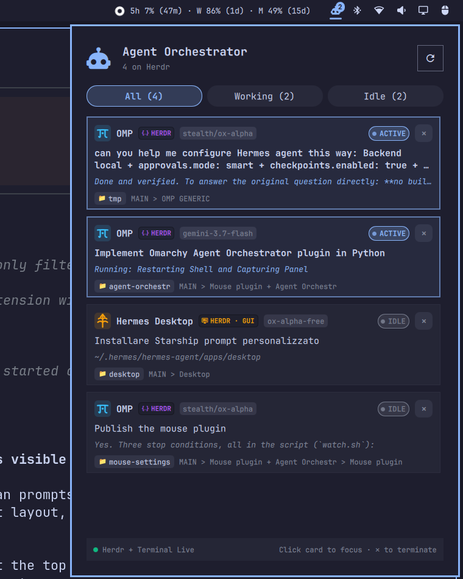
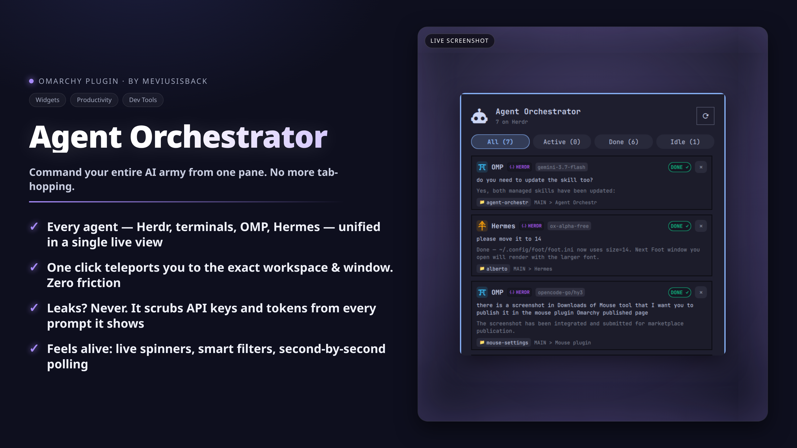

<div align="center">

# Agent Orchestrator

**Live status, active tasks and one-click workspace switching for AI coding agents — Herdr, OMP, Hermes, Claude, Codex, OpenCode, Agy and Grok — right in the Omarchy bar.**

[](LICENSE)





</div>

## Why

When several AI coding agents work at once — across terminals, Herdr panes and remote machines — you lose track of who's doing what and where. Agent Orchestrator collapses that into the bar: which agents are working, waiting or done, what they're doing, and one click to jump to the right workspace and window.

## Features

- **Live multi-source tracking** — Herdr daemon panes (local socket plus remote machines), **remote Hermes peers** (gateways registered with `hermes peer add`, read-only), standalone terminal windows (Ghostty, Foot, Kitty, Alacritty, WezTerm), **OMP** sessions (`~/.omp/agent/sessions/`), **Hermes** CLI and Desktop app databases (`~/.hermes/state.db`), and **Grok** Build TUI sessions (`$GROK_HOME/active_sessions.json` + `events.jsonl`).
- **One-click workspace & window switching** — click any agent card to switch Hyprland workspaces and focus the exact terminal window, Herdr pane or Hermes Desktop window.
- **Visual status bar display** — `Icon` mode (orchestrator glyph with activity badge and spinner while agents work), `Status` mode (real-time ticker of active tasks), `Compact` mode (live counts like `4 ag · 1 busy`, `3 done`).
- **Interactive popup panel** — smart filter tabs (`All`, `Working`, `Waiting`, `Done`, `Idle`); rich cards with model tags, latest human prompt, real-time tool execution, repo/working-directory breadcrumbs and session indicators; terminate agent processes or close Herdr panes from card buttons.
- **Privacy first** — automatic redaction of API keys and tokens from prompts and status lines; optional `privacyHidePrompts` hides all task text in bar and cards (counts, status, repo and workspace only) for screen sharing.
- **Adaptive fast polling** — 1 s live refresh while the popup is open or agents are working; configurable interval when idle.

## Install

Via the Omarchy Marketplace / plugin manager:

```bash
omarchy plugin add https://github.com/meviusisback/agent-orchestr --enable
```

Or manually — symlink into the plugins directory:

```bash
mkdir -p ~/.config/omarchy/plugins
ln -sfn ~/repo/agent-orchestr ~/.config/omarchy/plugins/meviusisback.agent-orchestr
```

then add it to the status bar layout in `~/.config/omarchy/shell.json`:

```json
{
  "id": "meviusisback.agent-orchestr",
  "barDisplay": "Icon",
  "refreshIntervalSec": 3
}
```

and restart the shell:

```bash
omarchy restart shell
```

## Usage

Toggle the popup with a global Hyprland key — add to `~/.config/hypr/bindings.lua`:

```lua
o.bind("SUPER + A", "Agent Orchestrator", "omarchy shell meviusisback.agent-orchestr toggle")
```

Shell IPC commands:

```bash
omarchy shell meviusisback.agent-orchestr toggle    # popup on/off
omarchy shell meviusisback.agent-orchestr open     # explicit open
omarchy shell meviusisback.agent-orchestr close    # explicit close
omarchy shell meviusisback.agent-orchestr refresh  # force live refresh
```

## Requirements

- Omarchy with Hyprland and the Quickshell shell
- `python3` (collector uses the standard library plus `http.client`)
- One or more agent runtimes to watch: Herdr, OMP, Hermes CLI/Desktop, Claude Code, Codex, Grok — standalone terminal windows are picked up with nothing installed
- Optional: `hermes` CLI (peer registration), `herdr` CLI (remote machines), the Claude Code status hook below for real Claude working/waiting/completed states

## Configuration

| Key | Default | Description |
|---|---|---|
| `barDisplay` | `"Icon"` | `"Icon"`, `"Status"` or `"Compact"` |
| `refreshIntervalSec` | `3` | Polling frequency in seconds |
| `showIdleInBar` | `false` | Badge count when all agents are idle |
| `maxTaskLength` | `45` | Max characters of the bar status ticker |
| `privacyHidePrompts` | `false` | Hide agent task/prompt text in bar and cards (counts, status, repo, workspace only) |

**Remote sources (read-only — no focus, no terminate; those windows aren't on this desktop):**

- **Herdr** — save a machine with `herdr machine add`, verify SSH access and a matching remote Herdr install. The plugin reads enabled rows from `herdr machine list --json` and queries each machine through the read-only `herdr --session <name> api snapshot`.
- **Hermes peers** — register the gateway once with Hermes itself (`hermes peer add <name> --url http://host:8377 --key <API_SERVER_KEY>`; remove with `hermes peer remove <name>`). The plugin reads the `bot_peers` block of `~/.config/hermes/config.yaml`, loads the key from `~/.hermes/.env` into an `Authorization` header only, and polls `GET /api/sessions` + `/api/sessions/<id>/messages`. Per tick it probes at most 4 peers (config order, rest reported as skipped) with ~5 calls and a 3 s budget each; `http://` LAN addresses are allowed, redirects never followed, proxies ignored. Peers on this machine (`127.x`, `::1`, `localhost`) are skipped — local discovery already covers them. Unreachable peers surface in the panel footer instead of silently showing no cards.
- **Hermes Desktop gateways** — only non-secret labels and URLs from `~/.config/Hermes/connections.json` are read; OAuth tokens stay with Hermes Desktop. A gateway also registered as a peer gets its label annotated with the peer's session count.

**Claude Code status (optional):** without help, every `claude` process reads as generic idle. For real `working` / `waiting` / `completed` states, install the bundled hook (purely additive — without it, behavior is today's fallback):

```bash
mkdir -p ~/.claude/hooks
cp hooks/claude-code-status.sh ~/.claude/hooks/
chmod +x ~/.claude/hooks/claude-code-status.sh
```

then merge its `PreToolUse`, `UserPromptSubmit`, `Notification`, `Stop`, `SubagentStop` and `SessionEnd` entries into `~/.claude/settings.json` (merge the matchers alongside existing entries — don't replace the array). Each status file is keyed by the `claude` PID (walked from the hook's `$PPID`), removed on `SessionEnd`, pruned when a session was `SIGKILL`ed.

## How it works

`agent_ctl.py` collects every source into one JSON snapshot per tick — local processes/terminals, Herdr sockets, OMP sessions, Hermes databases (read-only `?mode=ro`), Claude hook files (trusted only with a known status + fresh timestamp), Grok roster/events through one guarded reader (ownership, symlink, size and budget checks; anything planted degrades to "no detail", never a wrong card) — and `Panel.qml` renders bar and cards from it. Every agent-supplied string passes secret redaction (API keys, tokens, the peer key itself) and renders as `Text.PlainText`, never rich text; peer transport uses `http.client` with the system CA bundle, bounded responses and a watchdog deadline per peer.

Verify with the hermetic suites (no network, no `hyprctl`, no real `~/.grok` or `~/.hermes`; the peer suite serving only a loopback `http.server`):

```bash
python3 tests/test_grok_sessions.py       # Grok collector fixtures
python3 tests/test_kill_target.py         # target verification, all patched
python3 tests/test_peer_sources.py        # peer parser, confined reader, transport guards
python3 tests/test_claude_hook_argv.py
python3 tests/test_discovery_regression.py
python3 tests/test_hermes_activity.py
python3 tests/test_remote_sources.py
```

## Removal

```bash
omarchy plugin remove meviusisback.agent-orchestr
```

Or remove the symlink from `~/.config/omarchy/plugins/meviusisback.agent-orchestr` and drop `"meviusisback.agent-orchestr"` from `~/.config/omarchy/shell.json`.

## License

MIT — see [LICENSE](LICENSE).
